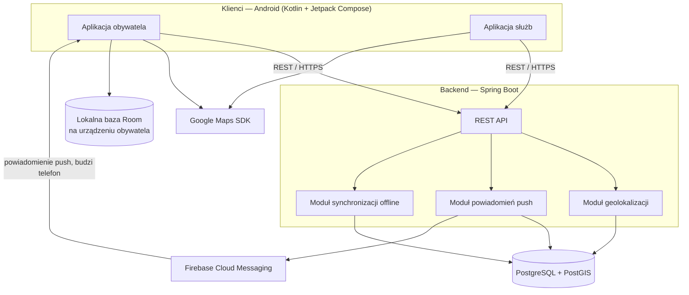
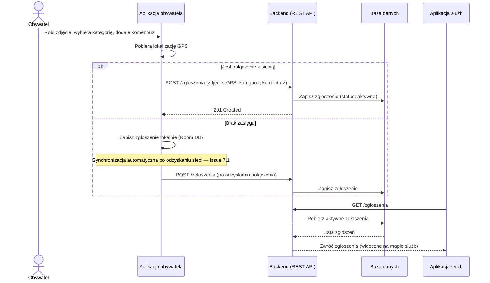
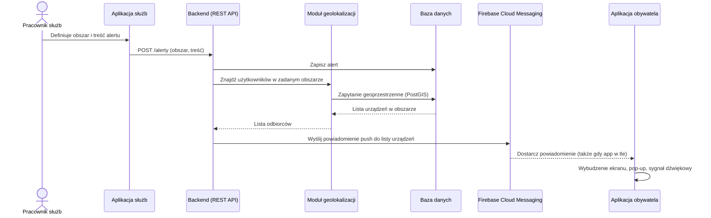

# Architektura systemu

**Powiązane issue:** #3
**Zależności:** ADR-0001 (`docs/adr/0001-wybor-stosu-technologicznego.md`)

Dokument realizuje kryteria akceptacji issue #3: diagram komponentów systemu oraz opis przepływu danych dla dwóch kluczowych scenariuszy.

> **Założenie do potwierdzenia w #5:** poniższy diagram traktuje moduł obywatela i moduł służb jako część **jednej natywnej aplikacji Android** (Kotlin + Jetpack Compose, zgodnie z ADR-0001), rozróżnianej rolą użytkownika po zalogowaniu — a nie jako osobne aplikacje/platformy. Jeśli w #5 zapadnie inna decyzja (np. osobny panel webowy dla służb), ten diagram wymaga aktualizacji.

---

## 1. Diagram komponentów

### Opis komponentów

| Komponent | Odpowiedzialność |
|---|---|
| Aplikacja obywatela | Zgłaszanie zdarzeń, SOS, mapa zagrożeń, alerty, tryb offline, karta medyczna, poradniki |
| Aplikacja służb | Oznaczanie zdarzeń, zmiana statusów, wysyłka alertów, podgląd jednostek ratunkowych |
| Backend / REST API | Warstwa pośrednicząca między klientami a bazą danych i usługami zewnętrznymi |
| Moduł geolokalizacji | Zapytania geoprzestrzenne: promień 100 m (system wiarygodności), najbliższa jednostka ratunkowa |
| Moduł powiadomień push | Wyzwala i formatuje wysyłkę alertów przez FCM |
| Moduł synchronizacji offline | Odbiera i porządkuje zgłoszenia wysłane z lokalnej bazy po odzyskaniu sieci |
| PostgreSQL + PostGIS | Trwałe przechowywanie danych, obliczenia geoprzestrzenne |
| Google Maps SDK | Wyświetlanie interaktywnej mapy po stronie klienta |
| Firebase Cloud Messaging | Dostarczanie powiadomień push do urządzeń, także gdy aplikacja jest w tle |
| Lokalna baza Room | Bufor zgłoszeń u obywatela, gdy brak zasięgu (issue 7.1) |

---

## 2. Przepływ: zgłoszenie obywatela → backend → widoczność u służb

**Kluczowe punkty:**
- Zgłoszenie trafia do backendu tą samą ścieżką niezależnie od trybu (online/offline) — różni się jedynie moment wysyłki.
- Backend nie rozróżnia zgłoszeń offline od online po stronie logiki biznesowej — to upraszcza implementację modułu synchronizacji.
- Widoczność u służb realizowana jest przez odpytywanie API (do rozstrzygnięcia w kolejnych issues, czy pull, czy WebSocket/push — patrz sekcja "Otwarte pytania").

---

## 3. Przepływ: alert kryzysowy — służby → backend → push do obywateli

**Kluczowe punkty:**
- Wyszukanie odbiorców odbywa się po stronie backendu (moduł geolokalizacji), nie na urządzeniu — obywatel nie musi mieć otwartej aplikacji, żeby dostać alert.
- Dostarczenie i wybudzenie telefonu zależy od FCM oraz od uprawnień systemowych Androida (kwestia do doprecyzowania w issue 5.2 — ograniczenia trybu Doze/oszczędzania baterii mogą wymagać wysokiego priorytetu wiadomości FCM).

---

## Otwarte pytania (do rozstrzygnięcia w kolejnych issues)

- Czy aplikacja służb pobiera nowe zgłoszenia przez odpytywanie (polling), czy przez WebSocket/subskrypcję push — wpływa na "czas rzeczywisty" mapy zagrożeń (issue 4.1).
- Ostateczny podział modułu obywatela / służb w ramach jednej aplikacji (routing, współdzielone komponenty) — issue #5.
- Format i struktura zapytań REST API (kontrakty endpointów) — do ustalenia przy pierwszych issues implementacyjnych (1.1, 3.1).
