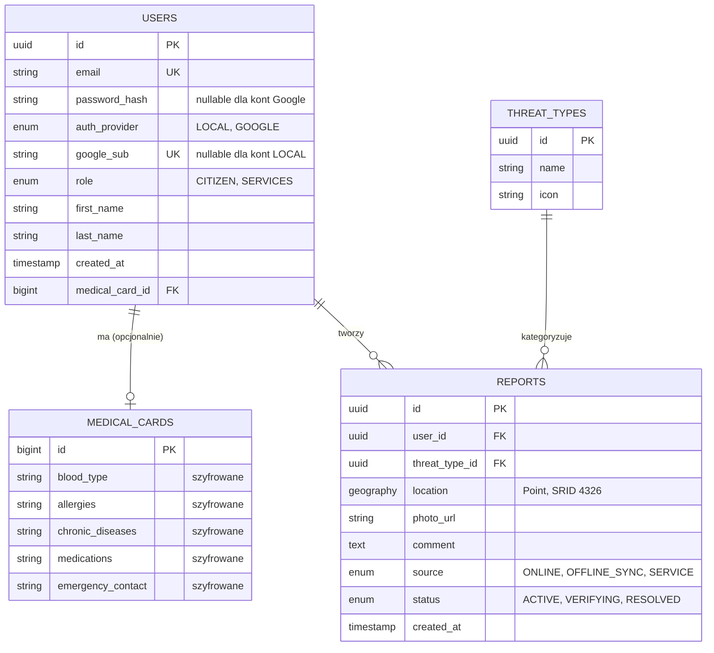
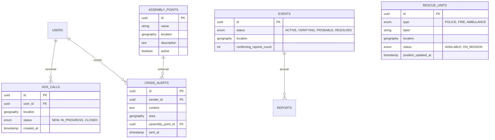

# Schemat bazy danych

**Baza:** PostgreSQL 16 + PostGIS 3.4 (Docker)
**Tworzenie schematu:** wersjonowane migracjami Flyway w `backend/src/main/resources/db/migration/`. Hibernate używa `ddl-auto: validate`, więc przy starcie sprawdza zgodność encji ze schematem, ale go nie zmienia.

Dokument składa się z dwóch części:
1. **Stan obecny** — tabele, które istnieją w bazie i są używane przez aplikację.
2. **Część planowana** — tabele zaplanowane w kolejnych issues, jeszcze niezaimplementowane (nazwy robocze).

---

## 1. Stan obecny (zaimplementowany)

### Opis tabel

| Tabela | Rola | Uwagi |
|---|---|---|
| `users` | Użytkownicy systemu (obywatele i służby) | Rola w kolumnie `role`; `auth_provider` określa `LOCAL` lub `GOOGLE`. `google_sub` jest unikalny i pusty dla kont lokalnych, a `password_hash` może być pusty dla kont Google. Seedowany użytkownik testowy jest wyłącznie profilem demonstracyjnym i nie ma danych logowania. Relacja z kartą medyczną 1:0..1 (klucz obcy w `users`). |
| `medical_cards` | Profil zdrowotny użytkownika | Pola wrażliwe szyfrowane algorytmem AES na poziomie JPA (`AttributeConverter`), w bazie przechowywane jako Base64. |
| `threat_types` | Słownik kategorii zagrożeń | Zamiast wolnego tekstu, żeby kategorie były spójne i filtrowalne. Początkowe wartości są wstawiane przez migrację `V2__insert_seed_data.sql`. |
| `reports` | Zgłoszenia zdarzeń widoczne na mapie | Lokalizacja jako typ geograficzny PostGIS. Status określa kolor pinezki. `reports` obecnie pełni również rolę zdarzenia; rozdzielenie zgłoszeń i zdarzeń pozostaje planowane w ramach issue #21. |

### Migracje i dane startowe

- `V1__init_schema.sql` tworzy kompletny schemat na pustej bazie PostgreSQL z PostGIS.
- `V2__insert_seed_data.sql` dodaje testowego użytkownika i typy zagrożeń.
- `V3__schema_compatibility_and_seed.sql` dopina ograniczenia logowania Google, nullable `password_hash` oraz bezpieczne zachowanie klucza karty. Ponawia inserty startowe w sposób idempotentny.
- Dla istniejącej bazy utworzonej przed Flyway należy ustawić `baseline-on-migrate: true` i baseline na wersji 2. Flyway pominie V1/V2 i wykona V3, która uzupełnia istniejący schemat. Pusta baza nie jest baseline'owana: wykonuje V1, V2 i V3.
- Lokalne połączenie i port PostgreSQL są konfigurowane w `application.yml` oraz `docker-compose.yml`. Na serwerze należy podać `SPRING_DATASOURCE_URL`, `SPRING_DATASOURCE_USERNAME` i `SPRING_DATASOURCE_PASSWORD`; serwer musi mieć PostgreSQL z PostGIS i uprawnienia do utworzenia rozszerzenia.

### Przegląd ERD względem encji

ERD dla zaimplementowanych tabel odpowiada encjom `User`, `MedicalCard`, `ThreatType` i `Report`: uwzględnia klucze główne, relację 1:0..1 użytkownik–karta medyczna, relacje raportu do użytkownika i typu zagrożenia oraz pola logowania lokalnego/Google. W aktualnym modelu raport jednocześnie reprezentuje zdarzenie wyświetlane na mapie; osobna tabela `events` i grupowanie raportów nie są częścią obecnego schematu i pozostają planowane.

### Statusy zgłoszenia

| Status | Kolor pinezki | Znaczenie |
|---|---|---|
| `ACTIVE` | czerwony | Zagrożenie aktywne |
| `VERIFYING` | żółty | W trakcie weryfikacji |
| `RESOLVED` | zielony | Zagrożenie rozwiązane |

Zmiana statusu: `PATCH /api/reports/{id}/status?status=...`

### Struktura karty medycznej

| Pole | Typ | Opis |
|---|---|---|
| `blood_type` | string (szyfrowane) | np. "A+", "0-" |
| `allergies` | string (szyfrowane) | wolny tekst |
| `chronic_diseases` | string (szyfrowane) | wolny tekst |
| `medications` | string (szyfrowane) | wolny tekst |
| `emergency_contact` | string (szyfrowane) | kontakt alarmowy jako jedno pole |

Endpointy: `GET`, `PUT`, `DELETE` na `/api/users/{userId}/medical-card`.

### Decyzja projektowa: uproszczenie względem pierwotnego projektu

Pierwotny projekt zakładał rozdzielenie **zgłoszenia** (pojedynczy raport obywatela) od **zdarzenia** (zweryfikowany incydent grupujący wiele zgłoszeń). Na obecnym etapie zgłoszenie pełni obie role: ma własny status i jest bezpośrednio wyświetlane na mapie. Rozdzielenie nastąpi razem z systemem wiarygodności zgłoszeń (issue #21), który wymaga grupowania zgłoszeń z tego samego miejsca w jedno zdarzenie.

---

## 2. Część planowana (niezaimplementowana)

Nazwy tabel są robocze i mogą się zmienić w trakcie realizacji.

| Tabela | Powiązane issue | Do czego służy |
|---|---|---|
| `sos_calls` | #19 (SOS) | Wezwania pomocy, osobno od zgłoszeń, bo to inny, krytyczny czasowo przepływ |
| `crisis_alerts` | #16 (alerty) | Powiadomienia wysyłane przez służby do obywateli w danym obszarze |
| `assembly_points` | #18 (nawigacja) | Bezpieczne punkty zbiórki wskazywane w alertach |
| `events` | #21 (wiarygodność) | Zdarzenie grupujące wiele zgłoszeń z jednego miejsca |
| `rescue_units` | #15 (jednostki) | Pozycje pojazdów służb na mapie. Bez relacji do `users`, traktowane jako niezależny strumień danych |
