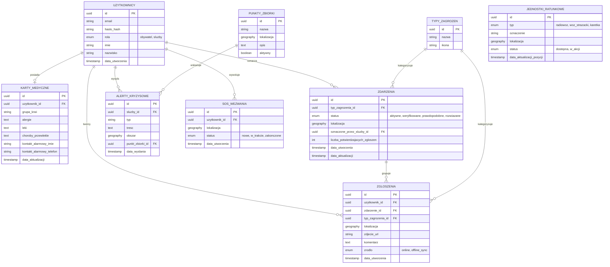
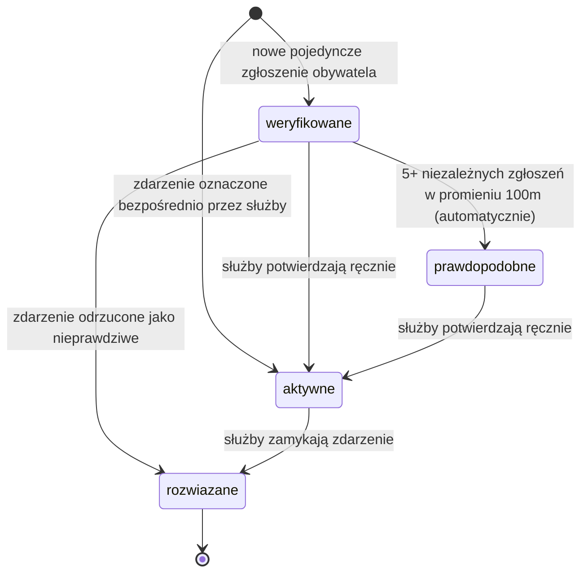

# Schemat bazy danych

**Powiązane issue:** #4
**Zależności:** #3 (`docs/architecture.md`)

Dokument realizuje kryteria akceptacji issue #4: diagram ERD, zdefiniowane statusy zdarzenia, zdefiniowana struktura karty medycznej.

---

## Kluczowa decyzja projektowa: zgłoszenie ≠ zdarzenie

Rozdzielamy dwie encje, które łatwo pomylić:

- **Zgłoszenie** (`ZGLOSZENIA`) — surowy, pojedynczy raport od jednego obywatela (zdjęcie, lokalizacja, kategoria, komentarz). To dane wejściowe.
- **Zdarzenie** (`ZDARZENIA`) — zweryfikowany incydent widoczny na mapie (pinezka, status, kolor). To dane wyjściowe, które faktycznie ogląda użytkownik.

Bez tego podziału nie da się sensownie zaimplementować systemu wiarygodności zgłoszeń (issue 6.3): kilka niezależnych zgłoszeń tego samego zagrożenia w promieniu 100 m musi się dać **zgrupować** w jedno zdarzenie i wspólnie wpływać na jego status. Jedno zdarzenie może więc mieć wiele powiązanych zgłoszeń (`zdarzenie_id` w tabeli `ZGLOSZENIA`).

Zdarzenie może też powstać od razu, bez żadnego zgłoszenia obywatela — gdy pracownik służb nanosi je ręcznie na mapę (issue 3.1).

---

## Diagram ERD

> **Uwaga:** `JEDNOSTKI_RATUNKOWE` celowo nie ma bezpośredniej relacji z `UZYTKOWNICY` — na tym etapie pozycje jednostek traktujemy jako niezależny strumień danych (np. z osobnego systemu/API służb), a nie jako coś przypisanego do konkretnego konta w naszej aplikacji. Jeśli to się zmieni, łatwo dodać FK do `UZYTKOWNICY`.

---

## Statusy zdarzenia (kryterium akceptacji nr 2)

| Status | Znaczenie | Kto/co go nadaje |
|---|---|---|
| `weryfikowane` | Zdarzenie zgłoszone, ale jeszcze niepotwierdzone — domyślny status dla pojedynczego zgłoszenia obywatela | System, automatycznie przy pierwszym zgłoszeniu |
| `prawdopodobne` | Co najmniej 5 niezależnych zgłoszeń w promieniu 100 m | System, automatycznie (issue 6.3) |
| `aktywne` | Zdarzenie potwierdzone jako realne | Służby — ręcznie, albo od razu przy oznaczeniu zdarzenia na mapie (issue 3.1) |
| `rozwiazane` | Zagrożenie zakończone/usunięte | Służby — ręcznie (issue 3.3) |

Kolory pinezek na mapie (issue 4.1) mapują się na te statusy: `aktywne` → czerwony, `weryfikowane`/`prawdopodobne` → żółty, `rozwiazane` → zielony.

### Przejścia między statusami

---

## Struktura karty medycznej (kryterium akceptacji nr 3)

| Pole | Typ | Opis |
|---|---|---|
| `grupa_krwi` | string | np. "A+", "0-" |
| `alergie` | text | wolny tekst, np. "penicylina, orzechy" |
| `leki` | text | aktualnie przyjmowane leki |
| `choroby_przewlekle` | text | np. cukrzyca, epilepsja, choroby serca |
| `kontakt_alarmowy_imie` | string | osoba do powiadomienia w razie wypadku |
| `kontakt_alarmowy_telefon` | string | numer telefonu do tej osoby |
| `data_aktualizacji` | timestamp | kiedy dane były ostatnio zmieniane przez użytkownika |

Relacja z `UZYTKOWNICY` jest **1:0..1** (`||--o|`) — nie każdy obywatel musi mieć wypełnioną kartę medyczną (funkcja opcjonalna, priorytet obniżony w rozmowie o issue 1.2), ale jeśli istnieje, jest dokładnie jedna na użytkownika. Dane te są odczytywane przy aktywacji SOS (issue 6.1).

---

## Pozostałe encje — krótki opis

| Encja | Do czego służy |
|---|---|
| `TYPY_ZAGROZEN` | Słownik kategorii (pożar, powódź, wypadek drogowy...) — zamiast wolnego tekstu, żeby kategorie były spójne w całej aplikacji i łatwe do filtrowania na mapie |
| `ALERTY_KRYZYSOWE` | Powiadomienia wysyłane przez służby do obywateli w danym obszarze (issue 5.1) |
| `PUNKTY_ZBIORKI` | Bezpieczne lokalizacje wskazywane w alertach, do których prowadzi nawigacja (issue 5.3) |
| `JEDNOSTKI_RATUNKOWE` | Aktualne pozycje pojazdów służb, widoczne na mapie obywatela (issue 4.2) |
| `SOS_WEZWANIA` | Osobna tabela dla wezwań SOS (issue 6.1) — rozdzielona od `ZGLOSZENIA`, bo to inny, krytyczny czasowo przepływ (bez zdjęcia, z automatycznym dołączeniem danych z karty medycznej) |

---
